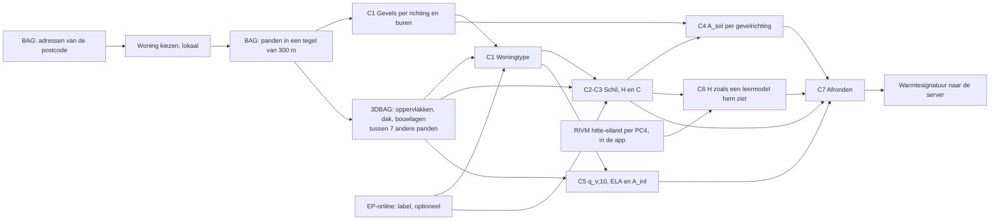

# Modelbijsluiter: berekende warmtesignatuur van een eengezinswoning

| | |
|---|---|
| Status | **Concept**, versie 0.1 van 21 november 2026. Nog niet gereviewd. |
| Rekenmethode | warmtesignatuur volgens AnonyMate, methode `passend` (standaard in de app); methodeversie **0.1** |
| Code | repository `needforheat-gearup-app`, map `apps/expo/src/lib/heatSignature/` (PR #35); een port van `signature.py` en `gevel.py` uit [AnonyMate](https://github.com/anonymate-nl/anonymate) |
| Auteur | Henri ter Hofte |
| Technische verklaring | bijlage bij deze bijsluiter |

## Leeswijzer

Deze bijsluiter is in drie lagen opgebouwd. Wie alleen de eerste laag leest, weet waar het over gaat;
wie verder leest, krijgt telkens meer detail.

| Laag | Wat | Voor wie |
|---|---|---|
| **Deel A. De grote lijn** (één pagina) | Wat de rekenwijze doet, in één schema | iedereen |
| **Deel B. Beschrijving en verantwoording** (§1 tot en met §6) | Doel, invoer, uitvoer, aannames, validatie, herreviewregel | de reviewer |
| **Deel C. De rekenstappen** (§C1 tot en met §C7) | Per rekenstap de vergelijkingen, constanten en hoe ze getoetst zijn | de reviewer die wil nagaan hoe er gerekend wordt |
| **Bijlage. Technische verklaring** | Of de code de rekenwijze correct uitvoert | ter kennisname |

Na deel C volgen de vragen aan de reviewers (§7). Variabelen dragen hun eenheid in de naam, na een
dubbele underscore (conventie `physiquant__unit`): `qv10__dm3_s_1_m_2` is een luchtdoorlatendheid in
dm³/(s·m²), `Asol__m2` een oppervlak in m², `buren__0` een dimensieloos aantal.

---

# Deel A. De grote lijn

**Wat de rekenwijze doet.** De NeedForHeat-app berekent voor **één eengezinswoning** uit openbare
gegevens een *warmtesignatuur*: vijf getallen die samen zeggen hoe de woning warmte verliest en
opvangt. Deze berekende signatuur gaat, grof afgerond, als antwoord op de vraag *woonadres
(warmtesignatuur)* (technisch de energy query `building-profile`) naar de onderzoeksserver,
naast de metingen (temperaturen, gas, stroom) waaruit later een *geleerde* signatuur volgt. De twee naast
elkaar laten zien waar een woning afwijkt van wat haar bouwjaar, vorm en label doen verwachten.

| Grootheid | Betekenis | Eenheid |
|---|---|---|
| H | warmteverliescoëfficiënt van de schil (transmissie) | W/K |
| C | effectieve warmtecapaciteit | Wh/K |
| τ = C / H | tijdconstante: hoe snel de woning afkoelt | h |
| A_sol | effectieve *horizontale* zonnetoetreding: zonwinst = A_sol × globale horizontale instraling | m² |
| A_inf | effectieve windapertuur: infiltratiedebiet = windsnelheid × A_inf | cm² |

**Warmtesignatuur, geen energiesignatuur.** De warmtesignatuur beschrijft het **gebouw**: hoe de schil warmte
doorlaat, vasthoudt en van zon en wind opvangt (H, C, τ, A_sol, A_inf). Een *energiesignatuur* legt het
**energiegebruik** uit tegen het weer, meestal het gas- of warmtegebruik tegen de buitentemperatuur of
graaddagen; daarin zitten ook het rendement van de installatie, de stooklijn en het gedrag van de bewoners.
Uit een energiesignatuur volgt de warmtesignatuur dus niet zonder meer, en omgekeerd. In deze bijsluiter,
in de app en in de handleidingen heet het daarom overal *warmtesignatuur* (niet gebouwprofiel,
energieprofiel of warmteprestatiesignatuur).

Daarnaast, nieuw in deze versie: de **luchtdoorlatendheid q_v;10** waarop A_inf rust (§C5). Het
**stedelijk hitte-eilandeffect** op de plek van de woning wordt in H verwerkt, niet los gepubliceerd
(§C6).

**Hoe de berekening loopt.**

**Wat eruit komt.** Per woning één set: H, C, A_sol, A_inf en q_v;10, elk afgerond in grove klassen
(§3, §C7). τ en de gebruikte methode gaan niet mee (ze maken de afgeronde waarden weer scherper of
verraden of er een label is). H is gecorrigeerd voor het stedelijk hitte-eiland, zodat hij vergelijkbaar
is met een H die met KNMI-weer is geleerd; de hitte-eilandwaarde zelf verlaat de telefoon niet.

**Waar het op leunt.** De U-waarden en ramen komen uit de RVO-voorbeeldwoningen 2022 bij bouwjaar en
type, bijgesteld met het energielabel als dat er is. Waar de ramen precies zitten weet niemand: ze
worden naar verhouding over de blootgestelde gevels verdeeld. De luchtdichtheid is de forfaitaire waarde
uit NTA 8800, niet gemeten (§4).

**Waarom we denken dat het klopt.** De app rekent hetzelfde als AnonyMate: 66 vergelijkingen (11
woningen × 6 methoden) komen tot op de afronding overeen. Het woningtype uit de buren klopt in 90-91%
met het geregistreerde type in EP-online. Een vergelijking van de berekende signatuur met geleerde
signaturen van echte woningen ontbreekt nog; dat is het grootste gat (§5).

**Privacy.** Het adres gaat niet naar de NeedForHeat-server, en geen bron krijgt het precieze adres of
pand in een verzoek: de app haalt breed op en kiest lokaal (§2, §C7).

---

# Deel B. Beschrijving en verantwoording

## 1. Doel en toepassingsgebied

### Welke vraag de rekenwijze beantwoordt

*Hoe zou deze woning warmte moeten verliezen en opvangen, als ze is zoals haar bouwjaar, vorm, ligging
en label doen verwachten?* Die verwachting dient als referentie naast de signatuur die uit metingen in
de woning wordt geleerd, en als achtergrondkenmerk in analyses over meerdere woningen.

### Waarvoor deze rekenwijze niet geschikt is

- **Appartementen en andere meergezinswoningen.** De rekenwijze vraagt één woning per pand (BAG); de
  app stopt anders met een duidelijke melding en stuurt niets.
- **Een energieadvies of label.** De signatuur is een grove verwachting uit openbare gegevens, geen
  opname. Verbouwingen die niet in een label staan, ziet ze niet.
- **Uitspraken over één woning op uurbasis.** A_sol en A_inf zijn effectieve grootheden voor een
  leermodel over een stookseizoen.

## 2. Invoer en datasets

| Bron | Wat | Hoe opgevraagd (privacy) |
|---|---|---|
| [BAG](https://api.pdok.nl/kadaster/bag/ogc/v2) (Kadaster, via PDOK; geen sleutel) | verblijfsobjecten: adres, gebruiksoppervlak, gebruiksdoel, ligging | **per postcode (PC6)**, ongeveer 10-25 adressen; de woning wordt lokaal gekozen |
| idem | panden: contour, bouwjaar, gebruiksdoel, aantal verblijfsobjecten | **per tegel van 300 m** op een vast raster van 200 m (niet rond de woning); in een binnenstad bijvoorbeeld 458 panden, 440 KB |
| [3DBAG](https://3dbag.nl) (TU Delft; geen sleutel) | oppervlakken buitenmuur, grond, dak (plat/schuin), scheidingsmuur; daktype; bouwlagen | het eigen pand **plus 7 andere woonpanden uit de tegel**, in willekeurige volgorde (anonimiteitsset van 8) |
| [EP-online](https://www.ep-online.nl) (RVO; sleutel) | label, type, compactheid, warmtebehoefte | per adres (kan niet anders); alleen als de server een sleutel uitgeeft. Voorwaarden RVO: de sleutel niet aan derden geven, dus niet in campagnes met deelnemers |
| RVO-voorbeeldwoningen 2022 | U-waarden, raamaandeel, deur, compactheid per type en bouwjaarklasse | meegeleverd in de app (via AnonyMate) |
| KNMI De Bilt (260), uurwaarden stookseizoen 2025-26 | instralingsverhouding per gevelrichting (§C4), infiltratieconstante k (§C5) | als constanten in de code |
| [RIVM hitte-eilandeffect](https://www.atlasleefomgeving.nl/thema/klimaatverandering/kaarten) (2022, v2; CC Publiek Domein) | hitte-eilandeffect per PC4 | **meegeleverd in de app** (37 KB), geen verzoek |

Het adres zelf komt uit het adresscherm van de app (PDOK Locatieserver). **Bekend gat:** daar gaat de
getypte zoektekst nog wel naar PDOK; zie §7.

## 3. Uitvoer

| Property (server) | Bron | Standaardafronding (zonder campagneregel) |
|---|---|---|
| `heat_tr_building_cond__W_K_1` | H, **met het hitte-eiland verwerkt** (§C6) | 10 klassen (decielen) |
| `th_mass_building__Wh_K_1` | C | 5 klassen (kwintielen) |
| `aperture_sol__m2` | A_sol | 5 klassen |
| `aperture_inf__cm2` | A_inf | 5 klassen |
| `qv10__dm3_s_1_m_2` | q_v;10 (nieuw) | 5 klassen rond de forfaitaire ladder: 0,3 / 0,5 / 0,8 / 1,25 / 1,8 |

De klassengrenzen van H, C, A_sol en A_inf komen uit de landelijke populatie eengezinswoningen
(AnonyMate, 5,28 miljoen woningen) en houden samen 0,02% van de woningen in een groep kleiner dan 11.
De klassen voor q_v;10 zijn **nog niet** in die analyse meegenomen: q_v;10 hangt alleen af van type,
bouwjaarklasse en daktype en voegt daarom weinig toe, maar dat moet de analyse nog bevestigen. Hetzelfde
geldt voor de H met hitte-eilandcorrectie: die ligt tot ongeveer 13% lager dan de H waarop de
klassengrenzen zijn bepaald (§C6), dus de klassen blijven bruikbaar, maar de populatie van AnonyMate kent
de gecorrigeerde H nog niet (`sig_best_uhi_H`, kladbloknotitie 5 van AnonyMate).

## 4. Aannames

1. **Bouwkundige staat:** U-waarden en ramen van de RVO-voorbeeldwoning bij type en bouwjaarklasse,
   bij een label (of warmtebehoefte) geïnterpoleerd tussen de varianten oorspronkelijk / huidig / na
   maatregelen (methode `passend`: label als dat bruikbaar is, anders de beste schatting).
2. **Ramen** liggen naar verhouding van het blootgestelde geveloppervlak per richting, zijgevels voor de
   helft (§C4). De echte posities zijn onbekend.
3. **Gedeelde muren** (met welk pand ook: buurwoning, garage, schuur) krijgen geen zon en tellen niet
   als buitenmuur voor A_sol. Voor H telt de scheidingsmuur volgens 3DBAG niet mee.
4. **Luchtdichtheid** forfaitair volgens NTA 8800, bij maatwerk gehalveerd (§C5); niet gemeten.
5. **Klimaat** één stookseizoen in De Bilt voor de richtingsfactoren en de infiltratieconstante.
6. **Hitte-eiland:** de RIVM-waarde is een zomergemiddelde; welk deel in het stookseizoen geldt is
   onbekend. De app neemt het volle effect (s = 1, de standaard van AnonyMate) (§C6).

## 5. Validatiebewijs

### 5.1 Verificatie: rekent de app hetzelfde als AnonyMate?

`signature.test.tsx` vergelijkt elke uitkomst met waarden die AnonyMate zelf berekent
(`tools/make_fixtures.py` draait `anonymate.signature.compute` met `detail=True`): 11 woningen, waarvan
5 met gevelrichtingen en buren, × 6 methoden. H, C, τ, A_sol, A_inf, q_v;10, ELA, het gebruikte
woningtype en de bron van A_sol komen overeen tot op de afronding. `facades.test.tsx` toetst de
geometrie (vrijstaand, rij van vier, twee-onder-een-kap, schuur, aanraken op een hoek, ringrichting).

### 5.2 Validatie van onderdelen

- **Woningtype uit de buren** tegen EP-online (eengezinswoningen met label): 90,1% goed rond Zwolle,
  91,1% rond Leiden, tegen 68,8% en 69,7% met het aandeel scheidingsmuur uit 3DBAG (AnonyMate, commit
  `e97f2ff`).
- **q_v;10-ladder**: reproduceert 3,0 / 1,8 / 1,2 / 0,7 / 0,4 van het openbare Hestia-model (PBL) en de
  RVO-voorbeeldwoningen.
- **Instralingsverhouding**: het gemiddelde over N/O/Z/W is geschaald op de NTA 8800-waarde 0,731; het
  patroon over de richtingen komt uit KNMI-uurwaarden.

### 5.3 Validatie op woningniveau: het grootste gat

Er is nog geen vergelijking tussen deze berekende signatuur en geleerde signaturen uit metingen. De
NeedForHeat-proef levert die data; de analyse (welk leermodel, welke buitentemperatuur, wel of geen
hitte-eilandcorrectie) staat in §7.

## 6. Herreviewregel (concept)

Opnieuw reviewen bij een wijziging van de rekenwijze (een vergelijking, constante of databron) of van de
standaardafronding. Niet bij een bugfix of tekstwijziging zolang de 66 vergelijkingen met AnonyMate
gelijk blijven. Een nieuwe versie van AnonyMate overnemen betekent: fixtures opnieuw genereren en de
verschillen hier beschrijven.

---

# Deel C. De rekenstappen

## C1. Woning, pand, gevels en woningtype

1. **Woning kiezen.** De verblijfsobjecten van de postcode komen op; de app kiest lokaal het object
   waarvan straat en huisnummer(letter, toevoeging) gelijk zijn aan het gekozen adres.
2. **Tegel.** Alle panden in het vierkant van 300 m dat bestaat uit de rastercel van 200 m waar de
   woning in ligt, plus 50 m rand. Het vierkant ligt vast op het raster, dus het wijst niet naar de
   woning.
3. **Gevels per richting** (port van `anonymate.gevel`; RD-coördinaten): per contourrand de
   buitennormaal en het kompasazimut, in 8 sectoren van 45° (N, NO, O, ZO, Z, ZW, W, NW). Een rand is
   (deels) gedeeld als een rand van een ander pand er binnen **0,5 m** van ligt en bijna evenwijdig loopt
   (hoek < 15°); blootgesteld is wat overblijft. De hoofdas is de richting van de langste rand; een
   *zijgevel* is een blootgestelde rand waarvan de normaal loodrecht op de hoofdas staat (binnen 45°).
4. **Buren en blok.** Twee panden met een woning zijn buren bij minstens **2 m** gedeelde muur; buren die
   aan elkaar vast zitten vormen een blok.
5. **Woningtype**, in deze volgorde: geregistreerd type (EP-online) → uit de buren (geen buren:
   vrijstaand; blok van twee: twee-onder-een-kap; één buur in een langer blok: hoekwoning; anders
   tussenwoning) → uit 3DBAG (niet aaneengebouwd: vrijstaand; aandeel scheidingsmuur < 0,44:
   twee-onder-een-kap; anders tussenwoning). Alleen de buren kunnen hoekwoning en twee-onder-een-kap
   onderscheiden.

Het RD-raster wijkt hooguit ongeveer 2° af van het ware noorden; daar wordt niet voor gecorrigeerd.

## C2. Schil en U-waarden

Uit 3DBAG: buitenmuur, grondvlak, plat en schuin dak. Ramen = buitenmuur × raamaandeel van de
voorbeeldwoning; dicht = buitenmuur − ramen − deur. U-waarden: NTA 8800-forfaits naar bouwjaar
(`nta8800`), of de voorbeeldwoning geïnterpoleerd op het label (`best`, `ep`), met de
maatwerkcorrecties van Van den Brom e.a. (2022) behalve bij `nta8800`. Met een label met
compactheid (`ep`, `ep_3dbag`) schaalt het verliesoppervlak naar A_ls = compactheid × A_g.

## C3. H, C en τ

H = Σ A_i · U_i over gevel, ramen, deur, vloer (× b-factor) en dak. C volgt uit de specifieke
warmtecapaciteit per bouwperiode × gebruiksoppervlak; τ = C / H.

## C4. A_sol per gevelrichting

A_sol vermenigvuldigt de **globale horizontale** instraling (wat het KNMI meet). Een raam staat
verticaal en vangt een richtingsafhankelijk deel daarvan: de verhouding R_o = instraling op een
verticaal vlak gericht naar o / instraling op een horizontaal vlak, over het stookseizoen.

**Richtingsfactoren** (KNMI De Bilt, oktober-april 2025-26; NOAA-zonnestand, diffuse fractie volgens
Erbs, omzetting volgens Hay & Davies, albedo 0,2; geschaald zodat het gemiddelde van N/O/Z/W gelijk is
aan de NTA 8800-waarde 0,731):

| N | NO | O | ZO | Z | ZW | W | NW |
|---|---|---|---|---|---|---|---|
| 0,311 | 0,401 | 0,684 | 1,053 | 1,240 | 1,061 | 0,689 | 0,399 |

**Verdeling.** Met G_o het blootgestelde geveloppervlak per richting en Z_o het zijgeveldeel daarvan:
gewicht ramen w_o = G_o − Z_o + s · Z_o, met s = 1 voor vrijstaand en 0,5 anders. Dan
r_raam = Σ w_o R_o / Σ w_o, en r_muur volgt uit de dichte gevel per richting (bruto gevel per richting
min wat ramen en deur daar innemen). A_sol = ramen · (1 − F_F) · g · F_w · F_sh · r_raam
+ dicht · α · R_se · U_gevel · r_muur + deur · α · R_se · U_deur · r_raam + dak · α · R_se · U_dak.

`nta8800` en `mwa` blijven bewust richtingsgemiddeld (0,731): standaardconform en vergelijkbaar met de
voorbeeldwoningen. Zonder pandcontour valt ook `passend` terug op 0,731 (`asol_bron__cat` =
`gemiddeld`). **Effect:** een tussenwoning met voor- en achtergevel op zuid en noord krijgt een 11%
grotere A_sol dan dezelfde woning op oost en west (8,31 tegen 7,47 m² in de testgevallen).

## C5. Infiltratie: q_v;10, ELA en A_inf

1. **Forfaitaire luchtdoorlatendheid**, NTA 8800 vgl. (11.86): q_v;10 = f_type · f_y · q_spec
   [dm³/(s·m²)], **genormeerd op de gebruiksoppervlakte A_g** (§11.2.5, vgl. 11.85, opmerking 2; NEN
   2686). f_y naar bouwjaar: vóór 1970 3,0; 1970 2,5; 1980 2,0; 1990 1,5; 2000 1,0; 2010 en later 0,7.
   q_spec: 1,0 schuin dak, 0,7 plat dak. f_type: tussenwoning 1,0, hoekwoning en twee-onder-een-kap 1,2,
   vrijstaand 1,4. Bij maatwerk (alle methoden behalve `nta8800`) × 0,5.
2. **Effectief lekoppervlak (ELA)**, de Amerikaanse *effective leakage area* bij 4 Pa met
   uitstroomcoëfficiënt 1: het oppervlak van één opening die bij 4 Pa evenveel lucht doorlaat als de
   hele schil. q10 = q_v;10 · A_g [L/s] bij 10 Pa; terug naar 4 Pa met de stroomwet q ∝ Δp^n, n = 0,67;
   ELA = q4 / √(2 · Δp / ρ), ρ = 1,2 kg/m³. Zie Sherman & Grimsrud (1980), *Measurement of infiltration
   using fan pressurization and weather data* (LBL-10852,
   [AIVC](https://www.aivc.org/sites/default/files/Sherman2.pdf)) en het
   [overzicht van LBNL-publicaties over effective leakage area](https://eta-publications.lbl.gov/publication-keywords/effective-leakage-area);
   het model staat ook in het ASHRAE Handbook of Fundamentals, hoofdstuk infiltratie.
3. **LBL-model** (beschuttingsklasse 3, voorstedelijk): debiet [L/s] = ELA [cm²] · √(C_s·ΔT + C_w·v²),
   met C_s = 0,000145 / 0,000290 / 0,000435 en C_w = 0,000319 / 0,000420 / 0,000494 voor 1 / 2 / 3
   bouwlagen (3DBAG, begrensd op 1..3; onbekend telt als 2).
4. **Linearisatie** tot de A_inf van het leermodel (debiet = v · A_inf; 1 cm² · 1 m/s = 0,1 L/s), zo dat
   het warmteverlies over een stookseizoen gelijk is: A_inf = 10 · Σ debiet_LBL · ΔT / Σ v · ΔT = k · ELA,
   met k = 0,2300 / 0,2877 / 0,3310 voor 1 / 2 / 3 bouwlagen (KNMI De Bilt, stookseizoen 2025-26,
   T_binnen 20 °C).

**Hoe A_inf en q_v;10 zich verhouden.** Alles bij elkaar is A_inf evenredig met q_v;10 en het
gebruiksoppervlak:

  ELA ≈ 2,10 · q_v;10 · A_g  [cm², met q_v;10 in dm³/(s·m²) en A_g in m²]
  A_inf = k · ELA ≈ 0,60 · q_v;10 · A_g  (2 bouwlagen; 0,48 bij 1 laag, 0,69 bij 3)

Voorbeeld (testgeval tussenwoning 1975, 110 m², maatwerk): q_v;10 = 2,5 × 0,5 = 1,25 → ELA = 288 cm² →
A_inf = 0,2877 × 288 = 82,9 cm². Bij 4 m/s wind is dat 33 L/s, ongeveer 40 W/K extra verlies.

**Waarom q_v;10 nu ook wordt gepubliceerd.** q_v;10 is de grootheid die een blowerdoortest (NEN 2686)
meet en waarin NTA 8800, het PBL-model Hestia en de voorbeeldwoningen rekenen. A_inf is een afgeleide
voor één leermodel, met een linearisatie en een klimaatjaar erin. Wie later een gemeten q_v;10 heeft,
of een ander infiltratiemodel wil gebruiken, kan met q_v;10 verder; A_inf is dan uit q_v;10, A_g en het
aantal bouwlagen terug te rekenen. Het ligt daarom voor de hand om op termijn q_v;10 als primaire
grootheid te nemen en A_inf alleen nog als afgeleide (§7, vraag 3).

**Schoorsteeneffect.** Het LBL-model kent naast wind een thermische trek: de term C_s · ΔT, die met
het aantal bouwlagen groeit (een hogere woning trekt sterker). In het leermodel bestaat alleen de
windterm (debiet = v · A_inf). De linearisatie in stap 4 houdt het **seizoenstotaal** gelijk, dus het
gemiddelde schoorsteenverlies zit wel in A_inf, maar verdeeld naar de wind in plaats van naar het
temperatuurverschil: op koude, windstille dagen schat het leermodel de infiltratie te laag, op zachte,
winderige dagen te hoog. Zo doet ook het simulatiemodel van *Slim stroomgebruik thuis*
(`simulatiemodel/infiltratie.py`) het: daar rekent het LBL-model per uur, met wind én trek, zonder
linearisatie. Een expliciete schoorsteenterm in de signatuur is mogelijk (§7, vraag 4).

## C6. Stedelijk hitte-eiland

Een leermodel dat zijn buitentemperatuur van een KNMI-station of een interpolatie daartussen haalt
(zoals de vraag *woonlocatie (weerzone)* van NeedForHeat), ziet een stadswoning minder warmte verliezen dan het
station doet vermoeden, en schat dus een kleinere H.

**Data, compact.** RIVM-kaart *Stedelijk hitte-eiland effect* (10 m raster, 1-6-2022, v2), door AnonyMate
per PC6 bemonsterd op de BAG-adrespunten, in de app teruggebracht tot **één waarde per PC4**, gewogen
naar het aantal adressen, in tienden van een kelvin: 4.056 postcodes, **37 KB**, geen verzoek nodig
(`uhi.ts`, `tools/make_uhi_pc4.py`). Tegenover de PC6-waarde wijkt het PC4-gemiddelde 0,21 K af (RMS
over adressen; P90 0,34 K). Landelijk is het effect gemiddeld 0,85 K (mediaan 0,82; 38% boven 1 K).

**Waarom in H en niet als los getal.** AnonyMate heeft dat doorgerekend (`docs/herleidbaarheid-uitleg.md`,
eengezinswoningen van 50 tot 250 m² met label; gepubliceerd: weerzone, type, label en een afgeronde
signatuur):

| opzet | aandeel in een groep < 11 | bits onthuld |
|---|---:|---:|
| geen hitte-eiland | 2,9% | 12,2 |
| hitte-eiland verwerkt in de berekening | 2,9% | 12,2 |
| plus hitte-eiland als kolom, op 1 °C | 5,7% | 13,1 |
| plus hitte-eiland als kolom, op 0,5 °C | 8,1% | 13,8 |
| plus hitte-eiland als kolom, op 0,1 °C | 20,8% | 15,8 |

Als los getal is het een **locatiewijzer**: binnen een weerzone verschilt het per postcode (spreiding
0,4 °C), en zelfs op 1 °C afgerond verdubbelt het aandeel te kleine groepen. Verwerkt in de berekening
kost het niets: de aanvaller rekent de gecorrigeerde H net zo goed uit het adres als de ongecorrigeerde.
Er is dus geen keus: de app verwerkt het in H en publiceert het niet apart.

**Hoe.** De app rekent H om naar wat een leermodel met KNMI-weer (of de geïnterpoleerde weerzone van
NeedForHeat, §C7) zou vinden:

  H_gepubliceerd = H · (T_binnen − T_buiten − s · UHI) / (T_binnen − T_buiten)

met T_binnen = 18,33 °C en T_buiten = 6,44 °C (stookseizoensgemiddelden, AnonyMate `as_learned`) en
s = 1 (`UHI_SHARE__0` in `uhi.ts`; AnonyMate rekent met 0, 0,5 en 1 en heeft nog niet gekozen). Bij
UHI = 1 K is H 8,4% kleiner; bij het negentigste percentiel van de eengezinswoningen ongeveer 13%.
Zonder bekende waarde (postcode niet in de tabel) blijft H ongecorrigeerd. C, A_sol en A_inf
veranderen niet. De ongecorrigeerde H staat niet op de server; wie hem nodig heeft, deelt door de factor
hierboven (het algoritme en de tabel zijn openbaar).

**Andersom kan ook, maar niet bij NeedForHeat.** AnonyMate noemt als veilige weg ook: het leermodel
rekenen met lokaal weer (station plus hitte-eiland), zodat het de werkelijke H vindt. Daarvoor moet de
partij die leert het hitte-eiland per woning kennen, dus de locatie. De NeedForHeat-server kent bewust
alleen een verschoven H3-cel van niveau 5 (§C7); daarom gebeurt de correctie in de app, aan de kant van
de berekende signatuur.

## C7. Afronden en privacy van de inname

**Afronden.** Alles wat naar de server gaat, wordt in de app afgerond met de regels van de campagne of
de standaardregels (§3); waarden zonder regel gaan niet mee. Het algoritme is openbaar, dus voor een
aanvaller is de berekende signatuur een exacte sleutel: alleen grove klassen houden groepen groot
genoeg (k ≥ 11).

**Inname (PET's, privacy-enhancing technologies).** Volgens het ontwerpprincipe *breed ophalen, lokaal
kiezen* (Slim stroomgebruik thuis, kladbloknotitie 8):

| Verzoek | Wat de bron ziet | Anonimiteitsset |
|---|---|---|
| BAG verblijfsobjecten | een postcode (PC6) | ongeveer 10-25 adressen |
| BAG panden | een vaste tegel van 300 m | honderden panden |
| 3DBAG | 8 panden uit de tegel, door elkaar | 8 |
| EP-online (alleen met sleutel) | het adres | 1 |
| Hitte-eiland | niets (in de app, verwerkt in H) | alle |

**Weerzone.** De vraag *woonlocatie (weerzone)* (`weather-interpolation-location`) stuurt geen adres maar het
midden van een H3-cel van **niveau 5** (ongeveer 250 km²), **na een willekeurige verschuiving** met
normaal verdeelde ruis van **σ = 10 km** per richting (`utils/weatherLocation.ts`). De verschuiving
wordt één keer per installatie getrokken en bewaard, zodat opnieuw antwoorden geen nieuwe steekproeven
rond de woning geeft die je kunt middelen. Volgens de analyse met AnonyMate (`weerspoor`: een aanvaller
legt de weerreeks naast KNMI-uurwaarden en zoekt de gebruikte locatie) is dat even veilig als niveau 4
zonder ruis (ongeveer 1.770 km²) en geeft het nauwkeuriger weer.

De woningtypebepaling uit de buren past hier precies in: ze heeft de omliggende panden toch nodig, dus
het ophalen per tegel kost niets extra. Het oude pad vroeg BAG en 3DBAG per object en de Locatieserver
op het volledige adres.

---

## 7. Vragen bij de review van deze rekenwijze

1. **Adresinvoer.** Het adresscherm stuurt de getypte tekst naar de PDOK Locatieserver. Is het de moeite
   om ook daar alleen op postcode te zoeken (en huisnummers lokaal te tonen)?
2. **q_v;10 in de afronding.** De vijf klassen zijn nog niet samen met H, C, A_sol en A_inf door de
   afrondingsanalyse van AnonyMate gegaan. Doen voordat een campagne met deelnemers start.
3. **Overstappen op q_v;10?** Moet q_v;10 de primaire infiltratiegrootheid worden, met A_inf als
   afgeleide voor het leermodel? Dan kan een gemeten q_v;10 (blowerdoortest) de forfaitaire vervangen.
4. **Schoorsteeneffect expliciet?** Twee mogelijkheden:
   (a) zo laten: het seizoensgemiddelde trekverlies zit in A_inf (§C5);
   (b) splitsen: A_inf alleen uit de windterm (k met C_s = 0), en het trekverlies als extra
   geleidingsterm H_trek [W/K] bij H, gelineariseerd over het stookseizoen (het groeit met ΔT^1,5, maar
   ligt dichter bij ΔT dan bij v). Variant (b) past alleen als het leermodel aan de andere kant dezelfde
   opdeling maakt; anders verschuift het alleen verlies van A_inf naar H. Welk leermodel gebruikt de
   NeedForHeat-analyse?
5. **Welk deel van het hitte-eiland (s)?** De app verwerkt het volle zomereffect (s = 1) in H. Zodra
   AnonyMate de varianten 0 / 0,5 / 1 tegen gemeten woningen heeft getoetst (kladbloknotitie 5), s
   daarop aanpassen; dat is een wijziging van de rekenwijze (§6).
6. **Ramen naar richting.** Het raamaandeel per richting volgt het geveloppervlak (zijgevel ½). Is er
   een betere openbare bron, bijvoorbeeld de ramen in 3DBAG LoD2.2?

## Afkortingen

| Afkorting | Betekenis |
|---|---|
| BAG | Basisregistratie Adressen en Gebouwen |
| 3DBAG | 3D-versie van de BAG (TU Delft, 3D geoinformation) |
| ELA | effective leakage area, effectief lekoppervlak bij 4 Pa |
| EP-online | landelijke database energielabels (RVO) |
| KNMI | Koninklijk Nederlands Meteorologisch Instituut |
| LBL | Lawrence Berkeley Laboratory (infiltratiemodel van Sherman & Grimsrud) |
| NTA 8800 | Nederlandse norm voor de energieprestatie van gebouwen |
| PC4 / PC6 | postcode met 4 cijfers / met 4 cijfers en 2 letters |
| PET | privacy-enhancing technology |
| RD | Rijksdriehoeksstelsel (EPSG:28992) |
| RIVM | Rijksinstituut voor Volksgezondheid en Milieu |
| RVO | Rijksdienst voor Ondernemend Nederland |
| UHI | urban heat island, stedelijk hitte-eilandeffect |
| H3 | hiërarchisch zeshoekig raster (Uber); niveau 5 is ongeveer 250 km² |

## Bijlage. Technische verklaring

- **Code.** `signature.ts` en `facades.ts` hebben geen imports en draaien ook los onder Node;
  `publicData.ts` haalt de gegevens op, `uhi.ts` zoekt het hitte-eiland op en verwerkt het in H (`applyUhiToH`).
- **Tests.** `signature.test.tsx` (66 vergelijkingen met AnonyMate), `facades.test.tsx` (geometrie),
  `publicData.test.tsx` (adres kiezen, tegel, hitte-eiland), `lib/privacy/rounding.test.tsx`
  (afronding). Ze draaien in de CI bij elke pull request.
- **Reproduceerbaarheid.** De verwachte waarden komen uit AnonyMate (`tools/make_fixtures.py`, met de
  AnonyMate-checkout als argument); de hitte-eilandtabel uit de PC6-tabel van AnonyMate
  (`tools/make_uhi_pc4.py`). Beide scripts staan naast de code.
- **Bekende beperkingen.** Een rij die langer is dan de tegel wordt korter geteld; dat verandert het
  type niet (alleen een blok van precies twee telt apart). Een tegel in een binnenstad kan enkele honderden
  KB zijn (proef: 458 panden, 440 KB in het centrum van Amersfoort); de app haalt hooguit vijf pagina's
  van 1.000 panden op.
